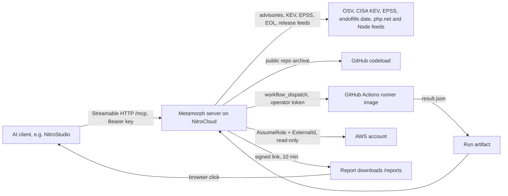

<div align="center">

# metamorph

**Assess, plan and verify legacy PHP and Node upgrades from your AI client.**

[](https://github.com/dhilipa01/metamorph-mcp/actions/workflows/ci.yml)


[Dashboard](https://metamorph-6ae4a33e-dhilipan-sankar-fronthyre.app.nitrocloud.ai/app) · [Docs](docs/) · [Evidence](docs/EVIDENCE.md)

</div>

Built with the NitroStack TypeScript SDK for the NitroStack buildathon, Enterprise AI track.

## Why Metamorph

- **The problem.** Old PHP and Node apps pile up known-vulnerable dependencies and end-of-life runtimes. Nobody wants to touch the code blind, and a flat audit list does not say what to do first.
- **One call from your AI client.** Give it a public GitHub repo URL. It scores the repo, ranks what matters first, plans a staged upgrade, shows the exact diff and, after an explicit approval, builds the patch on a throwaway copy. Your repo is never modified. You get a patch and a report (PDF, SARIF, SBOM).
- **Server-side, not a skill file.** OSV, CISA KEV, EPSS and endoflife.date are fetched by the server, and `apply_stage` refuses without a valid signed token, whatever the model says. No install or repo checkout on your machine.
- **Scoped keys.** `read`, `plan`, `write`, enforced per tool.
- **Composable.** Structured JSON plus a plain patch, so a client can combine it with other MCP servers (no specific pairing tested).
- **Where free tools already win:** plain version-bump pull requests (Dependabot, Renovate) and single-ecosystem audits (`npm audit`, `composer audit`). Metamorph is worth using for the combination: ranked triage, a plan, a diff, a report.

Scope today: upgrade, not rewrite. Public GitHub repos only.

## Quick start

1. **Try it with no AI client.** Open `https://metamorph-6ae4a33e-dhilipan-sankar-fronthyre.app.nitrocloud.ai/app`, paste a key (it stays in the tab), run Assess, Plan, Preview and Report.
2. **Get a key.** Keys are issued by the deployment owner (no public sign-up). `read` runs everything except `plan_modernization` (`plan`) and `apply_stage` / `verify_patch` (`write`). Ask for `plan` at least.
3. **Connect your agent.**
   - URL `https://metamorph-6ae4a33e-dhilipan-sankar-fronthyre.app.nitrocloud.ai/mcp` (must end in `/mcp`), header `Authorization: Bearer <YOUR_API_KEY>`.
   - NitroStudio: Add Server, Other Project, Connection Type HTTP (Streamable HTTP), paste the URL, Authentication Bearer Token, paste the key.
   - Check: `curl -s -o /dev/null -w "%{http_code}\n" https://metamorph-6ae4a33e-dhilipan-sankar-fronthyre.app.nitrocloud.ai/mcp/health` prints `200`.
4. **First call**, `assess_project`:
   ```json
   { "repo_url": "https://github.com/dhilipa01/metamorph-demo-legacy", "subfolder": "php-shop" }
   ```
   You get a 0-100 score, findings (known-exploited first), runtime end-of-life, dependency counts and the score widget (seconds to under a minute).
5. **Next:** `plan_modernization` with `"goal": "patch_advisory"`, then `preview_changes` with `"stage": "patch-dependencies"` (copy the stage id from the plan). It returns a diff and an `approvalToken`; `apply_stage` (write key) must be called within 300 s.
6. **Optional:** `check_watch` with `{ "cve_ids": ["CVE-2021-44228"], "products": ["php@8.1"] }`.

Errors name the next step: `401` wrong or missing key, `403` scope too low. Smoke test a deployment: `METAMORPH_URL=https://metamorph-6ae4a33e-dhilipan-sankar-fronthyre.app.nitrocloud.ai scripts/smoke.sh` (add `METAMORPH_KEY` for authenticated checks).

## Tools

Flow: assess > plan > preview > apply / verify > report. You then run `git apply` yourself and assess again. Scopes are cumulative: `read` < `plan` < `write`. Labels come from `docs/EVIDENCE.md` (see Status).

| Tool | Scope | What it does | Label |
|---|---|---|---|
| `analyze_advisory` | read | Checks advisory ids (up to 10) or `ecosystem:name@version` packages (up to 50) against OSV | LIVE |
| `assess_project` | read | Scans a public GitHub repo (Node or PHP): score, ranked findings, runtime EOL, dependencies. Widget | LIVE |
| `plan_modernization` | plan | Staged plan for goal `patch_advisory`, `upgrade_runtime` or `modernize_all`, with risk, steps, rollback. Widget | LIVE |
| `preview_changes` | read | Diff for one stage and a 300 s approval token bound to plan, patch and stage. Guided stages return steps, not a diff | LIVE |
| `apply_stage` | write | Verifies the token, patches a temp copy, returns the patch and a projected score. Changes nothing in your repo. Widget | PROJECTED |
| `verify_patch` | write | Baseline and patched runs on a GitHub Actions runner, measured results, resumable by run id. Needs operator setup (`docs/RUNNER_SETUP.md`). Widget | FIXTURE (runner itself LIVE) |
| `generate_report` | read | PDF, SARIF 2.1.0 and CycloneDX 1.5 SBOM with signed 10 minute links. Optional `include_cloud`. Widget | LIVE (widget FIXTURE) |
| `check_watch` | read | CISA KEV status, EPSS, end-of-life dates and release feeds for CVE ids and products | LIVE (feeds row) |
| `cloud_inventory` | read | Read-only AWS inventory (Lambda, RDS, EKS, EC2) with end-of-life findings (`docs/AWS_SETUP.md`) | EMULATOR |

`apply_stage` is read-only by annotation but needs `write`, because scope is about who may approve. Inputs have length caps; a bad input gets one message naming the field, the next step and an example, never the value.

MCP capabilities used: tools (all annotated), resources (`metamorph://report/...`, `metamorph://aws/readonly-role.yaml`), prompts (`modernize`, `cve-triage`, `watch-repo`; text only, listed and fetched over MCP locally, not yet confirmed in NitroStudio), one MCP Apps widget (`score-dashboard`), signed HTTP downloads (`GET /reports/<id>.<pdf|sarif|cdx.json>?t=<token>`), annotations, scopes. Not used: elicitation (approval is a signed token you pass back). Transport: Streamable HTTP at `/mcp`.

<details>
<summary><b>Architecture</b></summary>



Modules in `src/modules` (design notes: `ARCHITECTURE.md`):
- `intake`: `analyze_advisory`, OSV client and bulk lookup.
- `assessment`: `assess_project`, repo fetch, PHP and Node inventory, rules, score, ranking.
- `planning`: `plan_modernization`, `preview_changes`, `apply_stage`, patch generators.
- `feeds`: `check_watch`, CISA KEV, EPSS, endoflife.date, release feeds.
- `report`: `generate_report`, PDF, SARIF, SBOM, signed downloads, `metamorph://report` resources.
- `verify`: `verify_patch`, GitHub Actions client, result schema.
- `scanners`: runner output normalised, deduplicated, scored, enriched.
- `cloud`: `cloud_inventory`, AWS read-only scan, `metamorph://aws` resource.
- `common`: key and scope guard, approval and download tokens, redaction, safe archive extraction, input validation.
- `widgets`: the score-dashboard widget (Next.js static export).
- `runner/`: Docker image and script run by the GitHub Actions workflow (trivy, semgrep, composer-audit, gitleaks, checkov, rector).

</details>

<details>
<summary><b>Security model</b></summary>

- Scopes enforced by a guard on every tool. 401 for a missing or wrong key, 403 for low scope, before any input message.
- Keys are hashed (SHA-256) at rest and compared in constant time over every entry.
- Approval token: HMAC-SHA256 bound to plan hash, patch hash and stage, 300 s lifetime. Forged, expired, changed or other-stage tokens are refused.
- Download links: HMAC-signed, 10 minutes, bound to the requesting key id. Still a bearer link: anyone holding the URL can fetch that one file until it expires, because a browser click cannot send a key. The `metamorph://report` resources are not key-bound.
- No repo code runs on the host: the repo is fetched as an archive and only read and parsed. Real builds and tests run in an isolated GitHub Actions runner.
- Archive handling: zip-slip, symlink and size/file-count checks, one unpack at a time.
- SSRF guard: the only caller-supplied location is `repo_url`; it must be `https://github.com/owner/repo`, no credentials or port, and the archive comes from `codeload.github.com`.
- Secret-looking strings are redacted from outputs and logs; secrets found in a repo are reported as key name and file only.
- OWASP MCP Top 10 mapping: `docs/THREAT_MODEL.md`. Reporting: `SECURITY.md`.

Honest limits:
- Replaying an approval token inside its 300 s is accepted on purpose (apply is idempotent). Single use is not claimed.
- Keys are issued by hand (environment variables on the host); rotation is by redeploy.
- Operator-configured credentials (runner token, AWS role) belong to the deployment owner. Users cannot connect their own yet.
- Tool selection was tested with a keyword matcher, not a live model: 20 of 29 intents hit (`docs/EVAL_RESULTS.md` section 5).
- The score is our own formula (start at 100, subtract fixed weights per severity), not an industry standard. 100 means nothing our checks detect, not "secure".

</details>

<details>
<summary><b>Configuration and local development</b></summary>

Needs Node 20 and npm; ports 3001 and 3002 free (widget server).

```bash
npm install
cp .env.example .env     # for local calls without a key set METAMORPH_AUTH=off (local only)
npm run build
npm run dev              # MCP server + widget server
METAMORPH_SKIP_DOCKER=1 npm test   # unit, security and ground-truth tests, no Docker
npm run test:security
npm run conformance      # MCP Inspector CLI against the built server (offline)
npm run eval             # 20-repo real corpus (network, about 6 minutes)
npm run load             # load and resilience script
```

Create a key:
```bash
node -e "const c=require('crypto');const k='sk_'+c.randomBytes(24).toString('base64url');console.log('KEY:',k);console.log('ENV: METAMORPH_KEY_OWNER=write:'+c.createHash('sha256').update(k).digest('hex'))"
```

Environment variables (names only; never commit `.env`):

| Name | Purpose |
|---|---|
| `METAMORPH_KEY_<LABEL>` | One per key: `<scope>:<sha256 hex of the key>` |
| `METAMORPH_TOKEN_SECRET` | 32+ characters. Signs approval tokens and download links. Without it `apply_stage` refuses and downloads answer 503 |
| `METAMORPH_PUBLIC_URL` | Origin the browser reaches the server at. Makes report links absolute |
| `METAMORPH_AUTH` | Local development only: turns key checks off. Never on a host |
| `METAMORPH_SANDBOX_DIR` | Optional temp folder for downloaded repos |
| `METAMORPH_GITHUB_TOKEN`, `METAMORPH_RUNNER_REPO`, `METAMORPH_RUNNER_REF` | Runner for `verify_patch` |
| `METAMORPH_AWS_ROLE_ARN`, `METAMORPH_AWS_EXTERNAL_ID`, `METAMORPH_AWS_REGIONS`, `AWS_ACCESS_KEY_ID`, `AWS_SECRET_ACCESS_KEY`, `AWS_SESSION_TOKEN`, `AWS_REGION` | AWS read-only scan |
| `MCP_TRANSPORT_TYPE`, `PORT`, `HOST`, `ENABLE_CORS` | NitroStack transport (`stdio`, `http`, `dual`) |
| `NITRO_MCP_PROTOCOL_VERSION`, `NITRO_LOG_LEVEL`, `NITROSTACK_APP_MODE` | NitroStack runtime |
| `METAMORPH_SKIP_DOCKER` | Tests only: `1` skips the Docker-based PDF/UA test |

Deployment: NitroCloud auto-deploys from `main`. Set the variables above in the app's environment settings and redeploy. Set `METAMORPH_PUBLIC_URL` to the deployed origin, or the report tool returns relative paths. Report files live in the memory of one server instance for 10 minutes; after expiry or a restart the link answers 404, so run `generate_report` again.

</details>

## Status: what is real, what is not

Copied from `docs/EVIDENCE.md` (written 2026-11-01). Labels: LIVE (run for real against real systems), EMULATOR (real client code over the wire against an emulator), FIXTURE (our code against hand-made or recorded data, fakes, or stubs), PROJECTED (an estimate computed by our own code), NOT BUILT.

| Capability | Label | Notes |
|---|---|---|
| assess_project, analyze_advisory (OSV, CISA KEV, EPSS, endoflife.date, php.net/Node feeds) | LIVE | Real public data. Rules and the 0-100 score formula are our own, not an industry standard. Built-in EOL tables are an offline fallback. |
| plan_modernization, preview_changes | LIVE | Real diffs on real fetched repos. |
| apply_stage | PROJECTED | Patch is real; the re-score uses a simulated lockfile refresh in our code on a temporary copy. Nothing in the user's repo changes. |
| Runner (GitHub Actions workflow, prebuilt image, PHP selection) | LIVE | Dispatched by hand twice on GitHub against php-shop (no patch). Real tool output (trivy, semgrep, composer-audit, gitleaks, checkov, rector). |
| verify_patch (dispatch, poll, artifact, verdict) | FIXTURE | Client tested only against a fake GitHub; NOT yet called live through the deployed server. |
| generate_report PDF / SARIF / SBOM, signed download links | LIVE | Real output, veraPDF PDF/UA-1 passes, link downloaded over real HTTP from the deployed server. SARIF acceptance by GitHub code scanning NOT tested. Key-id binding of links: unit-tested only on the deployed path. |
| Score dashboard widget | FIXTURE | Rendered with a mock host in a browser; report view not yet confirmed inside NitroStudio. Manifest example data is hand-written (the 17 -> 92 plan example is invented; 17 -> 41 apply example matches a real projected result). |
| Scanner normalise / dedupe / measured score | LIVE data, FIXTURE paths | Real runner output for php-shop (34 raw -> 18 distinct). npm-audit extraction never run on real output. |
| cloud_inventory (AWS) | EMULATOR | Moto 5.2.5: STS, Lambda, RDS, EKS, EC2 calls answered, 7/7. NOT run against a real AWS account; ExternalId/IAM enforcement, throttling and real pagination untested. |
| Demo repos (metamorph-demo-legacy: php-shop, node-orders, php-shop-modernized) | AUTHORED BY US | Built with planted vulnerable dependencies; php-shop-modernized is built to score 100; php-shop can never verify green (stub lockfile, no tests). |
| Automated modernization depth | LIMITED | Only 4 stages change files: dependency bumps, runtime version, committed .env handling, packaging templates. Everything else is guidance only. |

Not built: GitHub branch pull-request connector and alerts; Linear, Jira; Slack, Discord, email, n8n notifications; multi-tenant OAuth vault (user-connected credentials); Azure, IBM Cloud; SonarQube, Snyk pull-mode; a one-call `modernize` tool; elicitation; PHP-to-Node conversion (out of scope by decision); private-repository access; live end-to-end `verify_patch` through the deployed server; AWS scan against a real account.

<details>
<summary><b>Results</b></summary>

Only numbers that exist in `docs/EVAL_RESULTS.md` or `docs/EVIDENCE.md`.

| Result | Why we report it | Reproduce |
|---|---|---|
| 20 of 20 real repos assessed, 0 errors, median score 58, range 0 to 83, 123 s total, peak memory 127 MiB (run 2026-10-31) | Strongest evidence: real archives at pinned commits, repos we did not write, live OSV/EPSS/EOL data. Memory is far under the 500 MiB host limit, but the repos are small | `npm run build && npm run eval` (network, about 6 minutes) |
| Composer audit: we flagged the same 7 direct packages on 3 of 3 repos. npm audit: 20 of 22 packages matched; the 2 misses are dev-only and were beyond the old 50-package cap (since removed) | Independent cross-check. Lockfile repos only (7 of 20); 13 of 20 have no lockfile, so their dependency numbers are unverified | `npm run eval` (needs `npm` and `composer` on PATH) |
| Ground truth: 77 of 77 planted problems found, 0 false positives on 8 clean fixtures | Shows each rule does what it says. Fixtures and rules were written by the same people, so it does not show recall on unknown code | `npx vitest run ground-truth` |
| Conformance: 40 of 40 checks pass (9 tools; auth 401/403, schema, annotations, output size, input errors) | Protocol behaviour of the built server, offline with a stubbed network | `npm run build && npm run conformance` |
| Tests: 1349 passed, 19 skipped (Docker and emulator tests), 50 test files, fresh run 2026-11-01 | Logic coverage with fakes; proves logic, not real-world behaviour | `METAMORPH_SKIP_DOCKER=1 npm test` |
| veraPDF PDF/UA-1: generated PDFs pass, zero failed rules | Accessibility of the report | `docker pull verapdf/cli`, then `npm test` without `METAMORPH_SKIP_DOCKER` (about 2.5 minutes) |
| Real runner output on php-shop: 34 raw findings from trivy, composer-audit and semgrep became 18 distinct after deduplication | Shows normalising real tool output across tools | fixtures in `tests/fixtures/runner/` |

Bad results we also report: scores saturate (two repos score 0, so the scale cannot tell bad from hopeless); 13 of 20 repos have no lockfile, so versions are guesses and count at half weight; a slow OSV can push `assess_project` to 64 s (load test, loaded machine); high scores on very old code are possible because the score only weighs what the rules can see.

</details>

---

No LICENSE file in this repository yet.
