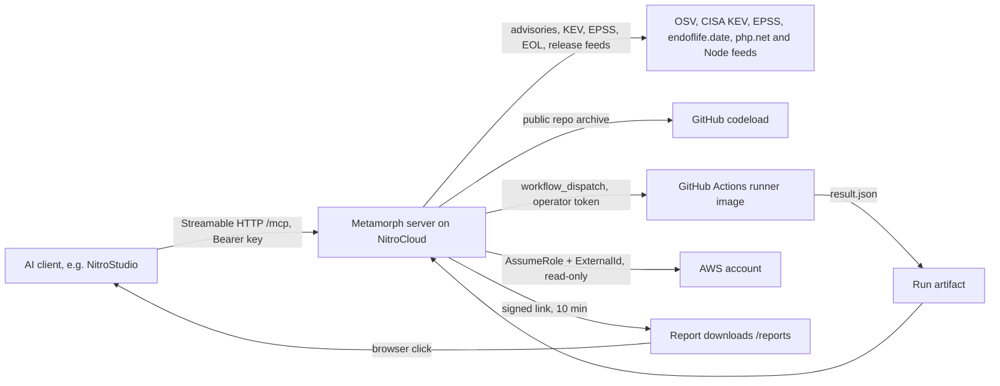

# Metamorph MCP

Legacy PHP and Node projects, assessed, planned and patched from your AI client. Built with the NitroStack TypeScript SDK for the NitroStack buildathon, Enterprise AI track.

## 1. What it is and the problem
- Old PHP and Node apps pile up known-vulnerable dependencies (CVEs) and runtimes that no longer get security fixes (end of life).
- Teams know it, but nobody wants to touch the code blind, and "what first?" is hard to answer from a flat audit list.
- Metamorph is an MCP server. You give it a public GitHub repo URL. It scores the repo, ranks what matters first, plans a staged upgrade, shows the exact diff, and (after an explicit approval) builds the patch on a throwaway copy.
- Your repo is never modified. You get a patch and a report (PDF, SARIF, SBOM) to forward.
- Scope today: upgrade, not rewrite. Public GitHub repos only. See sections 9 to 12 for what is real and what is not.

## 2. Why MCP is the right tool
- One URL and one key. No install, no local runtime, no repo checkout on your machine. The AI client calls the tools.
- Composable. Results are structured JSON plus a plain patch, so your client can combine them with other MCP servers you already use. We have not tested a specific pairing.
- Rendered in the client. A widget shows score, plan, patch result and report downloads inside the chat (section 5).
- Resources. Report files are also exposed as `metamorph://report/...` resources.
- Scoped keys. `read`, `plan`, `write` are enforced on the server, per tool.
- Versus a skill file: a skill is instructions. It has no live data (OSV, CISA KEV, EPSS, endoflife.date are fetched by the server), no access control, no way to make an approval binding. Here the server refuses `apply_stage` without a valid signed token, whatever the model says.
- Versus a CLI: a CLI runs on your machine with your permissions, needs installing per developer, has no key scopes, and cannot render a widget in the client. Metamorph does the fetch and analysis on the server, off your machine.
- Where free tools already win: plain version-bump pull requests (Dependabot, Renovate) and single-ecosystem audits (`npm audit`, `composer audit`). Metamorph is worth using for the combination: ranked triage, a plan, a diff, a report.

## 3. User flow
assess -> plan -> preview -> approve -> apply / verify -> report

| Step | Tool | What happens |
|---|---|---|
| 1. Assess | `assess_project` | Score, findings ranked known-exploited first, then severity, then EPSS |
| 2. Plan | `plan_modernization` | Ordered stages with risk, steps, rollback, projected score |
| 3. Preview | `preview_changes` | Files and unified diff for one stage, plus an `approvalToken` (300 s) |
| 4. Approve | you | You read the diff and pass the token back. Token is bound to plan, patch and stage |
| 5. Apply | `apply_stage` | Patches a throwaway copy, returns the patch and a PROJECTED before/after score |
| 6. Verify | `verify_patch` | Builds and tests the patch on an isolated GitHub Actions runner (needs operator setup, see section 12) |
| 7. Report | `generate_report` | PDF, SARIF 2.1.0 and CycloneDX 1.5 SBOM with signed download links |

You then run `git apply` yourself and call `assess_project` again to confirm.

## 4. Tools
Nine tools. Scopes are cumulative: `read` < `plan` < `write`. Label = status in `docs/EVIDENCE.md` (section 9).

| Tool | Scope | Annotations | What it does | Label |
|---|---|---|---|---|
| `analyze_advisory` | read | read-only, idempotent, open-world | Checks advisory ids (up to 10) or `ecosystem:name@version` packages (up to 50) against OSV | LIVE |
| `assess_project` | read | read-only, idempotent, open-world | Scans a public GitHub repo (Node or PHP): score, ranked findings, runtime EOL, dependencies. Widget | LIVE |
| `plan_modernization` | plan | read-only, idempotent, open-world | Staged plan for goal `patch_advisory`, `upgrade_runtime` or `modernize_all`. Widget | LIVE |
| `preview_changes` | read | read-only, idempotent, open-world | Diff for one stage and a short-lived approval token. Guided stages return steps, not a diff | LIVE |
| `apply_stage` | write | read-only, idempotent, open-world | Verifies the token, patches a temp copy, returns the patch and a projected score. Changes nothing in your repo. Widget | PROJECTED |
| `verify_patch` | write | not read-only, not destructive, not idempotent, open-world | Dispatches a baseline run and a patched run on a GitHub Actions runner, reads back measured results. Resumable by run id. Widget | FIXTURE (runner itself is LIVE) |
| `generate_report` | read | read-only, not idempotent, open-world | Always PDF + SARIF + SBOM, signed 10 minute links. Optional `include_cloud`. Widget | LIVE (widget FIXTURE) |
| `check_watch` | read | read-only, idempotent, open-world | CISA KEV status, EPSS, end-of-life dates and release/security feeds for CVE ids and products | LIVE (feeds row) |
| `cloud_inventory` | read | read-only, idempotent, open-world | Read-only AWS inventory (Lambda, RDS, EKS, EC2) with end-of-life findings | EMULATOR |

Notes
- `apply_stage` is read-only by annotation (it changes nothing in your environment) but needs `write` scope, because scope is about who may approve.
- Every input string and array has a length cap. A bad input gets one message naming the field, the next step and an example, and never echoes the value.
- Results carry a `nextStep` or `hint` naming the next tool.

## 5. MCP capabilities used
Used
- Tools: 9, with descriptions that state scope, side effects and step order.
- Tool annotations: `readOnlyHint`, `destructiveHint`, `idempotentHint`, `openWorldHint` on every tool (checked by the conformance run).
- Resources: `metamorph://report/{id}.pdf`, `.sarif`, `.cdx.json` and `metamorph://aws/readonly-role.yaml` (CloudFormation template for the read-only role).
- MCP Apps widget: one widget, `score-dashboard`, shared by `assess_project`, `plan_modernization`, `apply_stage`, `verify_patch` and `generate_report`. Views: assessment, plan, apply, verify, report, plus fallback cards for empty and unrecognised results.
- Signed HTTP downloads: `GET /reports/<id>.<pdf|sarif|cdx.json>?t=<token>` on the same server as `/mcp`.
- Auth and scopes: Bearer key, three cumulative scopes, a guard on every tool.
- Browser dashboard at `/app`: paste a key, run Assess, Plan, Preview and Report and see the real widget views (the key stays in the tab).
- Transport: Streamable HTTP at `/mcp`, health check at `/mcp/health`.

- Prompts: `modernize`, `cve-triage`, `watch-repo` (guided tool sequences; text only, they call nothing themselves). Listed and fetched over MCP locally; not yet confirmed in NitroStudio.
- Landing page at `GET /` (static, no external requests) replaces the SDK default page.

Not used (not built)
- Elicitation (approval is a signed token you pass back, not an in-client prompt).

## 6. Architecture

Module map (`src/modules`)
- `intake`: `analyze_advisory`, OSV client and bulk lookup.
- `assessment`: `assess_project`, repo fetch, PHP and Node inventory, rules, score, ranking.
- `planning`: `plan_modernization`, `preview_changes`, `apply_stage`, patch generators.
- `feeds`: `check_watch`, CISA KEV, EPSS, endoflife.date, release feeds.
- `report`: `generate_report`, PDF, SARIF, SBOM, signed downloads, `metamorph://report` resources.
- `verify`: `verify_patch`, GitHub Actions client, result schema.
- `scanners`: runner output normalised, deduplicated, scored, enriched.
- `cloud`: `cloud_inventory`, AWS read-only scan, `metamorph://aws` resource.
- `common`: key and scope guard, approval and download tokens, redaction, safe archive extraction, input validation.
- `widgets`: the score-dashboard widget (Next.js static export).
- `runner/`: Docker image and script run by the GitHub Actions workflow (trivy, semgrep, composer-audit, gitleaks, checkov, rector).
- Short design notes: `ARCHITECTURE.md`.

## 7. Quickstart (under 5 minutes)
1. Get a key.
   - Keys are issued by the deployment owner. Public sign-up is not built.
   - Judges receive a key from the owner, with its scope stated. `read` runs everything except `plan_modernization` (`plan`) and `apply_stage` / `verify_patch` (`write`). Ask for `plan` scope at least.
   - The server stores only the SHA-256 hash of a key. The plain key is shown once.
2. Connect.
   - URL: `https://<deployment-host>/mcp`. The path must end in `/mcp` (`Cannot POST /` means it does not).
   - Header: `Authorization: Bearer <YOUR_API_KEY>`.
   - NitroStudio: Add Server, Other Project, Connection Type HTTP (Streamable HTTP), paste the URL, Authentication Bearer Token, paste the key.
   - Check: `curl -s -o /dev/null -w "%{http_code}\n" https://<deployment-host>/mcp/health` prints `200`.
3. First call, `assess_project`:
   ```json
   { "repo_url": "https://github.com/dhilipa01/metamorph-demo-legacy", "subfolder": "php-shop" }
   ```
   You should see: a 0-100 score, findings with severity (known-exploited first), runtime end-of-life, dependency counts, and the score widget. Takes seconds to under a minute (OSV round trips).
4. Next calls: `plan_modernization` with `"goal": "patch_advisory"`, then `preview_changes` with `"stage": "patch-dependencies"` (copy the stage id from the plan). The preview shows a diff and an `approvalToken`.
5. Optional: `check_watch` with `{ "cve_ids": ["CVE-2021-44228"], "products": ["php@8.1"] }` for exploited-in-the-wild status and EOL date.
6. `apply_stage` needs a `write` key and the token; call it within 300 s of the preview.
7. Smoke test of a deployment: `METAMORPH_URL=https://<deployment-host> scripts/smoke.sh` (add `METAMORPH_KEY` for the authenticated checks).

Errors say the next step: `401` wrong or missing key, `403` scope too low, "Call preview_changes again and pass its approvalToken unchanged" for a bad token.

## 8. Run locally, tests, configuration
Requires Node 20 and npm. Ports 3001 and 3002 must be free (widget server).
```bash
npm install
cp .env.example .env     # for local calls without a key set METAMORPH_AUTH=off (local only)
npm run build
npm run dev              # MCP server + widget server
METAMORPH_SKIP_DOCKER=1 npm test   # unit, security and ground-truth tests, no Docker
npm run test:security
npm run conformance      # MCP Inspector CLI against the built server (offline)
npm run eval             # 20-repo real corpus (network, about 6 minutes)
npm run load             # load and resilience script
```
Without `METAMORPH_SKIP_DOCKER=1` the veraPDF PDF/UA test also runs (needs Docker and `docker pull verapdf/cli`, about 2.5 minutes).

Create a key (any terminal):
```bash
node -e "const c=require('crypto');const k='sk_'+c.randomBytes(24).toString('base64url');console.log('KEY:',k);console.log('ENV: METAMORPH_KEY_OWNER=write:'+c.createHash('sha256').update(k).digest('hex'))"
```

Environment variables (names only; never commit `.env`)

| Name | Purpose |
|---|---|
| `METAMORPH_KEY_<LABEL>` | One per key: `<scope>:<sha256 hex of the key>` |
| `METAMORPH_TOKEN_SECRET` | 32+ characters. Signs approval tokens and download links. Without it `apply_stage` refuses and downloads answer 503 |
| `METAMORPH_PUBLIC_URL` | Origin the browser reaches the server at. Makes report links absolute |
| `METAMORPH_AUTH` | Local development only: turns key checks off. Never on a host |
| `METAMORPH_SANDBOX_DIR` | Optional temp folder for downloaded repos |
| `METAMORPH_GITHUB_TOKEN`, `METAMORPH_RUNNER_REPO`, `METAMORPH_RUNNER_REF` | Runner for `verify_patch` (`docs/RUNNER_SETUP.md`) |
| `METAMORPH_AWS_ROLE_ARN`, `METAMORPH_AWS_EXTERNAL_ID`, `METAMORPH_AWS_REGIONS`, `AWS_ACCESS_KEY_ID`, `AWS_SECRET_ACCESS_KEY`, `AWS_SESSION_TOKEN`, `AWS_REGION` | AWS read-only scan (`docs/AWS_SETUP.md`) |
| `MCP_TRANSPORT_TYPE`, `PORT`, `HOST`, `ENABLE_CORS` | NitroStack transport (`stdio`, `http`, `dual`) |
| `NITRO_MCP_PROTOCOL_VERSION`, `NITRO_LOG_LEVEL`, `NITROSTACK_APP_MODE` | NitroStack runtime |
| `METAMORPH_SKIP_DOCKER` | Tests only: `1` skips the Docker-based PDF/UA test |

Deployment
- NitroCloud auto-deploys from `main`. Set the variables above in the app's environment settings, then redeploy.
- Set `METAMORPH_PUBLIC_URL` to the deployed origin, or the report tool returns relative paths.
- `METAMORPH_TOKEN_SECRET` must be 32+ characters.
- Report files live in the memory of one server instance, for 10 minutes. After expiry or a restart the link answers 404; run `generate_report` again.

## 9. Security model
- Scopes `read` < `plan` < `write`, enforced by a guard on every tool. 401 for a missing or wrong key, 403 for low scope, before any input message.
- Keys are hashed (SHA-256) at rest and compared in constant time over every entry.
- Approval token: HMAC-SHA256 bound to plan hash, patch hash and stage, 300 s lifetime. A forged, expired, changed or other-stage token is refused.
- Download links: HMAC-signed, 10 minutes, bound to the requesting key id. Still a bearer link: anyone holding the URL can fetch that one file until it expires, because a browser click cannot send a key. The `metamorph://report` resources are not key-bound.
- No repo code runs on the host. The repo is fetched as an archive and only read and parsed. Nothing from it is installed, built or run.
- Real builds and tests run in an isolated GitHub Actions runner, not on the server.
- Archive handling: zip-slip, symlink and size/file-count checks, one unpack at a time.
- SSRF guard: the only caller-supplied location is `repo_url`; it must be `https://github.com/owner/repo`, no credentials or port, and the archive comes from `codeload.github.com`.
- Redaction of secret-looking strings in outputs and logs. Secrets found in a repo are reported as key name and file only, never values.
- Mapping to the OWASP MCP Top 10: `docs/THREAT_MODEL.md`. Reporting: `SECURITY.md`.

Honest limits
- Replay of an approval token inside its 300 s is accepted on purpose (apply is idempotent). Single use is not claimed.
- Keys are issued by hand (environment variables on the host). No sign-up, rotation by redeploy.
- Operator-configured credentials (runner token, AWS role) belong to the deployment owner. Users cannot connect their own yet.
- Tool selection was tested with a keyword matcher, not a live model: 20 of 29 intents hit (`docs/EVAL_RESULTS.md` section 5).
- Our score is our own formula (start at 100, subtract fixed weights per severity). It is not an industry standard. 100 means nothing our checks detect, not "secure".

## 10. What is real and what is not
Copied from `docs/EVIDENCE.md` (written 2026-11-01). Labels: LIVE (run for real against real systems), EMULATOR (real client code over the wire against an emulator), FIXTURE (our code against hand-made or recorded data, fakes, or stubs), PROJECTED (an estimate computed by our own code), NOT BUILT.

| Capability | Label | Notes |
|---|---|---|
| assess_project, analyze_advisory (OSV, CISA KEV, EPSS, endoflife.date, php.net/Node feeds) | LIVE | Real public data. Rules and the 0-100 score formula are our own, not an industry standard. Built-in EOL tables are an offline fallback. |
| plan_modernization, preview_changes | LIVE | Real diffs on real fetched repos. |
| apply_stage | PROJECTED | Patch is real; the re-score uses a simulated lockfile refresh in our code on a temporary copy. Nothing in the user's repo changes. |
| Runner (GitHub Actions workflow, prebuilt image, PHP selection) | LIVE | Dispatched by hand twice on GitHub against php-shop (no patch). Real tool output (trivy, semgrep, composer-audit, gitleaks, checkov, rector). |
| verify_patch (dispatch, poll, artifact, verdict) | FIXTURE | Client tested only against a fake GitHub; NOT yet called live through the deployed server. |
| generate_report PDF / SARIF / SBOM, signed download links | LIVE | Real output, veraPDF PDF/UA-1 passes, link downloaded over real HTTP from the deployed server. SARIF acceptance by GitHub code scanning NOT tested. Key-id binding of links: unit-tested only on the deployed path. |
| Score dashboard widget | FIXTURE | Rendered with a mock host in a browser; report view not yet confirmed inside NitroStudio. Manifest example data is hand-written (the 17 -> 92 plan example is invented; 17 -> 41 apply example matches a real projected result). |
| Scanner normalise / dedupe / measured score | LIVE data, FIXTURE paths | Real runner output for php-shop (34 raw -> 18 distinct). npm-audit extraction never run on real output. |
| cloud_inventory (AWS) | EMULATOR | Moto 5.2.5: STS, Lambda, RDS, EKS, EC2 calls answered, 7/7. NOT run against a real AWS account; ExternalId/IAM enforcement, throttling and real pagination untested. |
| Demo repos (metamorph-demo-legacy: php-shop, node-orders, php-shop-modernized) | AUTHORED BY US | Built with planted vulnerable dependencies; php-shop-modernized is built to score 100; php-shop can never verify green (stub lockfile, no tests). |
| Automated modernization depth | LIMITED | Only 4 stages change files: dependency bumps, runtime version, committed .env handling, packaging templates. Everything else is guidance only. |

## 11. Results
Only numbers that exist in `docs/EVAL_RESULTS.md` or `docs/EVIDENCE.md`.

| Result | Why we report it | Reproduce |
|---|---|---|
| 20 of 20 real repos assessed, 0 errors, median score 58, range 0 to 83, 123 s total, peak memory 127 MiB (run 2026-10-31) | Strongest evidence: real archives at pinned commits, repos we did not write, live OSV/EPSS/EOL data. Memory is far under the 500 MiB host limit, but the repos are small | `npm run build && npm run eval` (network, about 6 minutes) |
| Composer audit: we flagged the same 7 direct packages on 3 of 3 repos. npm audit: 20 of 22 packages matched; the 2 misses are dev-only and were beyond the old 50-package cap (since removed) | Independent cross-check. Lockfile repos only (7 of 20); 13 of 20 have no lockfile, so their dependency numbers are unverified | `npm run eval` (needs `npm` and `composer` on PATH) |
| Ground truth: 77 of 77 planted problems found, 0 false positives on 8 clean fixtures | Shows each rule does what it says. Caveat: fixtures and rules were written by the same people, so it does not show recall on unknown code | `npx vitest run ground-truth` |
| Conformance: 40 of 40 checks pass (9 tools; auth 401/403, schema, annotations, output size, input errors) | Protocol behaviour of the built server, offline with a stubbed network | `npm run build && npm run conformance` |
| Tests: 1349 passed, 19 skipped (Docker and emulator tests), 50 test files, fresh run 2026-11-01 | Logic coverage with fakes; proves logic, not real-world behaviour | `METAMORPH_SKIP_DOCKER=1 npm test` |
| veraPDF PDF/UA-1: generated PDFs pass, zero failed rules | Accessibility of the report | `docker pull verapdf/cli`, then `npm test` without `METAMORPH_SKIP_DOCKER` (about 2.5 minutes) |
| Real runner output on php-shop: 34 raw findings from trivy, composer-audit and semgrep became 18 distinct after deduplication | Shows normalising real tool output across tools | fixtures in `tests/fixtures/runner/` |

Bad results we also report: scores saturate (two repos score 0, so the scale cannot tell bad from hopeless); 13 of 20 repos have no lockfile, so versions are guesses and count at half weight; a slow OSV can push `assess_project` to 64 s (load test, loaded machine); high scores on very old code are possible because the score only weighs what the rules can see.

## 12. Roadmap (not built)
- GitHub branch pull-request connector and alerts.
- Linear, Jira.
- Slack, Discord, email, n8n notifications.
- Multi-tenant OAuth vault (user-connected credentials).
- Azure, IBM Cloud.
- SonarQube, Snyk pull-mode.
- One-call `modernize` tool.
- Elicitation.
- PHP-to-Node conversion (out of scope by decision).
- Private-repository access (public GitHub repos only).
- Live end-to-end `verify_patch` through the deployed server (the runner itself works; the tool path is fixture-tested).
- AWS scan against a real account.

Setup guides for the optional parts: `docs/RUNNER_SETUP.md`, `docs/AWS_SETUP.md`.

## 13. License
No LICENSE file in this repository yet.
